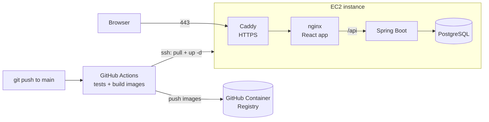

# RoomLedger

Shared-expense tracker for roommates: create a group, add shared expenses, see who owes whom and settle debts. The app is a ledger — it records payments made outside it, it does not move money.

> Work in progress.

## Tech stack

- **Backend:** Java 21, Spring Boot 3.5, Spring Data JPA, PostgreSQL 16, Flyway
- **Frontend:** React, TypeScript, Vite, TanStack Query, Tailwind CSS
- **Testing:** JUnit 5, Testcontainers, Vitest, Testing Library
- **DevOps:** Docker, Docker Compose, GitHub Actions

## Run locally

Requirements: Docker.

```bash
cp .env.example .env
docker compose up --build
```

- Frontend: http://localhost (port set by `FRONTEND_PORT` in `.env`)
- Backend health: http://localhost:8080/actuator/health
- API docs (Swagger UI): http://localhost:8080/swagger-ui.html

### Development without Docker for the apps

```bash
docker compose up -d postgres

# terminal 1 (the backend refuses to start without a JWT secret)
cd backend && JWT_SECRET=local-dev-secret-at-least-32-characters SPRING_PROFILES_ACTIVE=dev-fake ./mvnw spring-boot:run

# terminal 2
cd frontend && npm install && npm run dev   # http://localhost:5173
```

## Tests

```bash
cd backend && ./mvnw verify      # needs Docker running (Testcontainers)
cd frontend && npm run lint && npm run test
```

## Deployment

Production runs on a single AWS EC2 instance (`t3.small`, Ubuntu) with Docker Compose.



- **CI/CD:** every push to `main` runs the tests, builds both images, pushes them to GitHub Container Registry
  (tagged `latest` and with the commit SHA) and deploys them over SSH. The server never builds anything.
- **HTTPS:** Caddy obtains and renews a Let's Encrypt certificate automatically.
- **Network:** only ports 80/443 (and SSH) are open; PostgreSQL and the backend are reachable only inside Docker.
- **Secrets:** live in a `.env` file on the server (template: [`deploy/.env.production.example`](deploy/.env.production.example))
  and in GitHub Actions secrets for the SSH deploy key. Nothing secret is in the repository.
