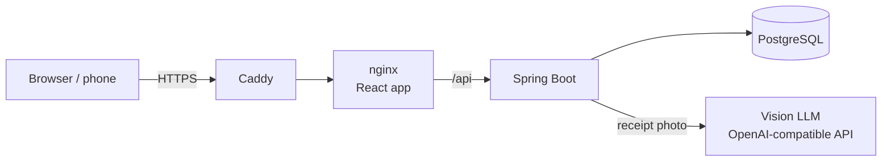
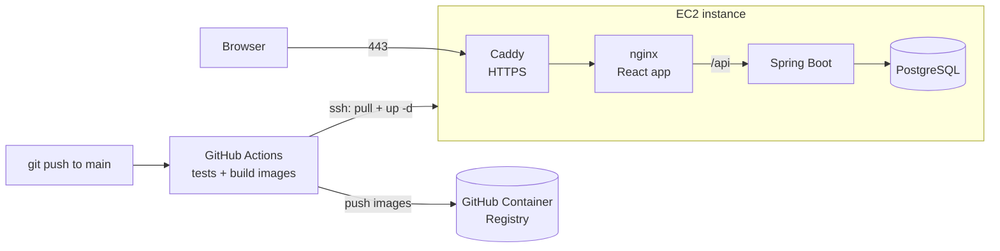

# RoomLedger

[](https://github.com/daniilban01/room-ledger/actions/workflows/ci.yml)

Shared-expense tracker for roommates: add shared expenses (or scan a receipt), see who owes whom,
and settle up with as few transfers as possible. The app is a ledger: it records payments made
outside it and does not move money.

**Live demo: https://63-184-91-32.sslip.io** — click **„Intră în contul demo”** on the login page.
Every click creates a private sandbox with sample roommates, expenses and payments, so you can
change anything without affecting other visitors. (The UI is in Romanian and built mobile-first.)

## Features

- **Groups** with invite codes; admins can rename, delete or regenerate the code.
- **Expenses** split equally, by exact amounts, or **per item** (each item assigned to the people who share it).
- **Receipt scanning**: a photo is read by a vision LLM and turned into an editable, itemized expense draft.
- **Balances** per member and **simplified debts**: the fewest transfers that settle the whole group.
- **Payments** in two steps: the payer marks "I paid", the receiver confirms or rejects it.
- **Activity log** of everything that happened in the group.

## Tech stack

- **Backend:** Java 21, Spring Boot 3.5, Spring Security (JWT), Spring Data JPA / Hibernate, PostgreSQL 16, Flyway
- **Frontend:** React 19, TypeScript, Vite, TanStack Query, React Router, Tailwind CSS
- **Testing:** JUnit 5, MockMvc, Testcontainers, JaCoCo, Vitest, Testing Library
- **DevOps:** Docker, Docker Compose, GitHub Actions, GitHub Container Registry, AWS EC2, Caddy

## Architecture

A modular monolith: one Spring Boot application, organized **by feature** (`auth`, `group`, `expense`,
`balance`, `settlement`, `activity`, `receipt`, `demo`), each with its own controller, service,
repository and DTOs. A single deployable is the right size for this problem; the feature packages
keep the boundaries clear if a part ever needs to be split out.



## Engineering decisions

**Money is never a floating-point number.** Amounts are `NUMERIC(12,2)` in the database, `BigDecimal`
in Java and integer cents in the frontend. When 100.00 is split three ways, the leftover cent is
assigned with the *largest remainder* method in a stable order, so the shares always add up exactly
to the total. Per-item splits are rounded **once for the whole receipt**, not per item, so rounding
errors cannot accumulate in favor of the same person.

**Debt simplification** (`DebtSimplifier`): net balances are matched greedily, largest creditor with
largest debtor, using two priority queues. That is O(n log n) and needs at most n − 1 transfers.
Finding the true minimum number of transfers is NP-hard (it contains the subset-sum problem), so the
greedy result is the practical trade-off; the UI shows how many direct debts it replaced.

**Balances are computed, not stored.** They are derived from expenses and confirmed payments with
aggregate SQL queries, so there is no stored total that can drift out of sync. The sum of all balances
in a group must be zero, and this is checked in code and in tests.

**Payments are a small state machine:** `PENDING → CONFIRMED | REJECTED`. Only the receiver can
confirm or reject, because only they know whether the money arrived. Only confirmed payments affect
balances.

**Concurrent edits** use optimistic locking (`@Version`): the client sends the version it loaded, and
a stale update gets `409 Conflict` instead of silently overwriting someone else's change. A test
confirms the same payment from two threads at once and expects exactly one success.

**The activity log is append-only, enforced by the database.** Events are written in the same
transaction as the change they describe (`Propagation.MANDATORY`), and PostgreSQL triggers reject
any `UPDATE`, `DELETE` or `TRUNCATE` on the table, so not even a bug or a manual SQL session can
rewrite history. For the same reason, deleting a group is a **soft delete**.

**Authorization lives in the backend.** Every group endpoint goes through one membership check.
Non-members get `404`, not `403`, so group ids cannot be probed. JWTs are stateless (HS256, 1 hour)
and the app refuses to start without a secret of at least 32 characters.

**LLM output is treated as untrusted input.** The receipt photo's type is checked by its magic bytes,
not its name. The model's JSON is parsed defensively and validated: amounts are bounded, invalid items
are dropped, and a mismatch between items and total is shown to the user as a warning. The user always
reviews the draft before saving. The external call:
- runs **outside** a database transaction, so a slow provider never holds a connection;
- retries `429` and `5xx` responses with exponential backoff;
- is rate-limited per user (sliding window, 10 scans per hour) to protect the API budget.

The provider is configurable (any OpenAI-compatible API); a fake parser is used in development and tests.

**Errors** follow RFC 7807 (`application/problem+json`), with per-field messages for validation errors.

**Demo sandboxes.** The public demo creates a fresh, isolated set of users and data for each visitor
through the normal services, so it passes the same validation as real data. Creation is rate-limited
globally, and sandboxes older than a day are cleaned up every night.

## Testing

- **Unit tests** for the pure logic: splitting and rounding, debt simplification, payment state
  transitions, receipt parsing and validation, JWT handling, rate limiting.
- **Integration tests** for every feature against a real PostgreSQL in Docker (Testcontainers),
  through HTTP with MockMvc, including authorization rules, concurrency and the database triggers.
- **Coverage:** about **96% of lines and 81% of branches**. JaCoCo fails the build below 90% / 75%,
  and every CI run publishes the numbers and the full HTML report.
- **Frontend:** Vitest tests for money formatting, splitting and the activity feed.

```bash
cd backend && ./mvnw verify                          # needs Docker running (Testcontainers)
cd frontend && npm run lint && npm run test
```

## Run locally

Requirements: Docker.

```bash
cp .env.example .env
docker compose up --build
```

- App: http://localhost (set `DEMO_ENABLED=true` in `.env` for the demo button)
- API docs (Swagger UI): http://localhost:8080/swagger-ui.html
- Receipts use a fake parser by default; set `SPRING_PROFILES_ACTIVE=default` and the `LLM_*`
  values in `.env` to read real receipts.

Development without Docker for the apps:

```bash
docker compose up -d postgres

# terminal 1 (the backend refuses to start without a JWT secret)
cd backend && JWT_SECRET=local-dev-secret-at-least-32-characters SPRING_PROFILES_ACTIVE=dev-fake ./mvnw spring-boot:run

# terminal 2
cd frontend && npm install && npm run dev   # http://localhost:5173
```

## Deployment

Production runs on a single AWS EC2 instance (`t3.small`, Ubuntu) with Docker Compose.



- **CI/CD:** every pull request runs the tests and builds both images. Every push to `main` also
  publishes the images to GitHub Container Registry (tagged `latest` and with the commit SHA) and
  deploys them over SSH. The server never builds anything.
- **HTTPS:** Caddy obtains and renews a Let's Encrypt certificate automatically and adds security headers.
- **Network:** only ports 80/443 (and SSH) are open; PostgreSQL and the backend are reachable only inside Docker.
- **Secrets** live in a `.env` file on the server (template: [`deploy/.env.production.example`](deploy/.env.production.example))
  and in GitHub Actions secrets for the SSH deploy key. Nothing secret is in the repository.
- **Database migrations** are versioned Flyway scripts applied automatically on startup.

## Privacy note

Receipt photos are sent to the configured LLM provider (Google Gemini on the live demo) to be read.
They are not stored by RoomLedger. Do not scan receipts with personal data on the demo.
